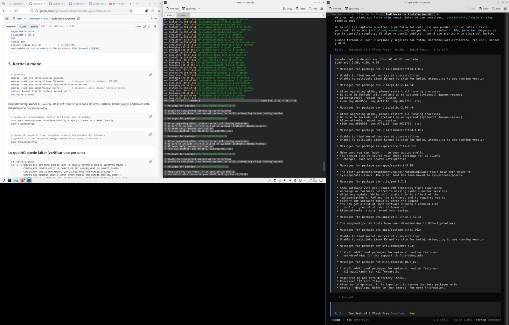

# Gentoo en endymion

Un registro de instalación, contado con las capturas del proceso.

**endymion** — i5-10400F, 15 GiB, Radeon RX 6600, NVMe de 512 GB.
Gentoo amd64, OpenRC, kernel 7.3.5, Sway sobre Wayland.
Instalado el **17/11/2026**, auditado el **20/11/2026**.

*17/11, 19:10. Jobs 61 of 61 complete. Ahí supe que el sistema iba a arrancar.*

---

## La historia, en corto

Venía de CachyOS: Arch con btrfs, LUKS y systemd. Andaba bien. El problema no era que
fallara, era que no entendía qué hacía cada capa. Gentoo promete lo contrario —que cada
pieza esté ahí porque la pusiste vos— y eso obliga a bajar hasta el kernel.
[Por qué lo hice y qué encontré](docs/experiencia.md).

Antes de tocar el disco lo ensayé dos días en una máquina virtual. Esa fue la mejor decisión
del proceso: la red, las particiones, `pam_faillock` y el primer `@world` se rompieron en un
disco virtual y no en el NVMe. [La fase de laboratorio](docs/vm.md).

El 17 de noviembre fue el día real: NVMe reparticionado, stage3 openrc, 61 paquetes
compilados, kernel 6.18.63 a mano, GRUB en la ESP y primer arranque. Todo quedó registrado
por un watcher que sacaba una foto cada 20 segundos.
[La cronología](docs/cronologia.md) · [las 24 capturas](docs/registro-instalacion/capturas/).

Lo que salió mal salió mal una vez: `localmodconfig` se comió los drivers de los discos de
datos, Tailscale pidió un `CONFIG_TUN` que no existía —y hubo que recompilar—, la red cambió
de nombre tres veces entre la documentación y el hierro, y `pam_faillock` bloqueó la cuenta
sin decir que era eso. [Cada error con su mensaje literal](docs/bitacora.md).

Lo mejor fue el kernel, driver por driver. Un kernel no es un programa que "hace andar
Linux": es el traductor entre el hardware y el resto del sistema, y cada opción del
`.config` responde a quién se encarga de qué.
[Qué driver necesita cada componente](docs/hardware.md).

Y sí: se parece a Arch, pero por mi culpa. Usé binarios para lo pesado y puse `~amd64`
global. La diferencia aparece cuando cambiás decisiones, no cuando compilás.
[La comparación honesta](docs/experiencia.md#es-solo-un-arch-no-le-veo-la-diferencia).

Hoy el sistema está sano y le faltan tres cosas: 102 rebuilds por el ABI de 32 bits que se
quedó a medias, un firewall, y dos decisiones que nunca se registraron (cifrado en reposo y
backup). [La auditoría completa](docs/auditorias/2026-11-20/README.md).

## El índice

### Empezá por acá

| Si querés… | Andá a |
|---|---|
| Instalar Gentoo en un equipo parecido | [`docs/guia-instalacion.md`](docs/guia-instalacion.md) |
| Entender qué pasó, en orden | [`docs/cronologia.md`](docs/cronologia.md) |
| Leer la opinión sin filtro | [`docs/experiencia.md`](docs/experiencia.md) |
| Ver qué está roto hoy | [`docs/auditorias/2026-11-20/`](docs/auditorias/2026-11-20/README.md) |

### La instalación

| Documento | Qué vas a encontrar |
|---|---|
| [`docs/guia-instalacion.md`](docs/guia-instalacion.md) | La guía ejecutable, de arriba abajo, sin abrir el handbook |
| [`docs/indice.md`](docs/indice.md) | El checklist para ir marcando cada paso |
| [`docs/bitacora.md`](docs/bitacora.md) | Fecha, qué se rompió con el mensaje literal, y cómo se resolvió |
| [`docs/cronologia.md`](docs/cronologia.md) | Las cuatro fases consolidadas: VM, fierro, escritorio y kernel |
| [`docs/vm.md`](docs/vm.md) | El ensayo en la máquina virtual, como laboratorio |
| [`docs/decisiones.md`](docs/decisiones.md) | Cada bifurcación y el motivo de la elección |

### La experiencia

| Documento | Qué vas a encontrar |
|---|---|
| [`docs/experiencia.md`](docs/experiencia.md) | Qué me gustó, qué no, con qué renegué y la comparación con Arch |
| [`docs/conceptos.md`](docs/conceptos.md) | Las explicaciones con analogías |
| [`docs/auditorias/2026-11-20/README.md`](docs/auditorias/2026-11-20/README.md) | El estado real del sistema y 19 hallazgos priorizados |

### Las pruebas

| Documento | Qué vas a encontrar |
|---|---|
| [`docs/registro-instalacion/`](docs/registro-instalacion/) | El watcher: comandos, 90 cambios y las 24 capturas |
| [`docs/registro-instalacion/capturas/`](docs/registro-instalacion/capturas/) | La galería completa, del primer minuto al último |
| [`docs/auditorias/instalacion-hardware-2026-11-17.md`](docs/auditorias/instalacion-hardware-2026-11-17.md) | La auditoría hecha desde el live, antes del primer arranque |
| [`docs/auditorias/2026-11-20/estado/`](docs/auditorias/2026-11-20/estado/) | Las salidas crudas de la auditoría y el `emerge.log` |
| [`docs/historial-paquetes.md`](docs/historial-paquetes.md) | Cada sesión de `emerge` con fecha y paquetes |

### La referencia y el backup

| Documento | Qué vas a encontrar |
|---|---|
| [`configs/endymion/`](configs/endymion/) | La configuración real: Portage, flags, mirrors, fstab, GRUB, Sway y el kernel en uso |
| [`configs/README.md`](configs/README.md) | Cómo restaurarla y qué no se copia a propósito |
| [`scripts/capturar-configs.sh`](scripts/capturar-configs.sh) | Regenerar ese backup en un comando |
| [`docs/hardware.md`](docs/hardware.md) | Qué driver necesita cada componente y dónde está en el menú del kernel |
| [`docs/audio.md`](docs/audio.md) | PipeWire, WirePlumber, Bluetooth y codecs A2DP |
| [`docs/migracion.md`](docs/migracion.md) | Qué hacer con los paquetes de la distro anterior |
| [`docs/retomar.md`](docs/retomar.md) | Cómo volver al chroot después de apagar |
| [`configs/`](configs/) | Lo de la VM y la planificación previa, como registro histórico |

## Los números

5 días de instalación · 697 merges en 66 sesiones · 739 paquetes · 3 kernels compilados ·
24 capturas automáticas · 102 rebuilds pendientes.

## Estado

En uso desde el 17/11. Portage consistente, Sway con Steam y Tailscale andando.
Lo que falta está en la [auditoría](docs/auditorias/2026-11-20/README.md): los rebuilds por
ABI de 32 bits, el firewall y dos decisiones que nunca se registraron (cifrado y backup).

## Reglas del repositorio

Solo texto y configuración. Las capturas van como evidencia en `docs/img/` y
`docs/registro-instalacion/capturas/`. Nunca claves, tokens, contraseñas ni direcciones
internas: todo lo que entre al historial sigue ahí.
