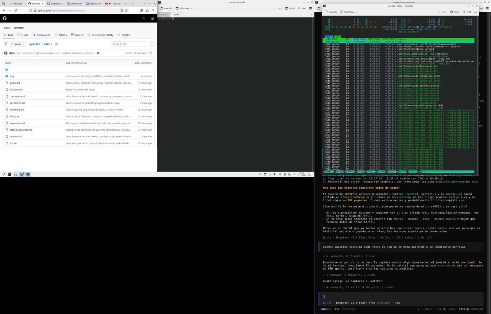
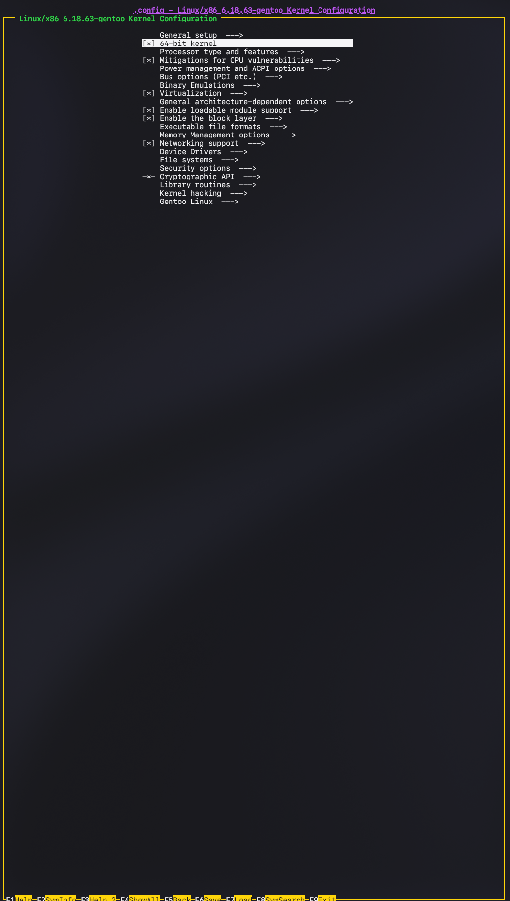
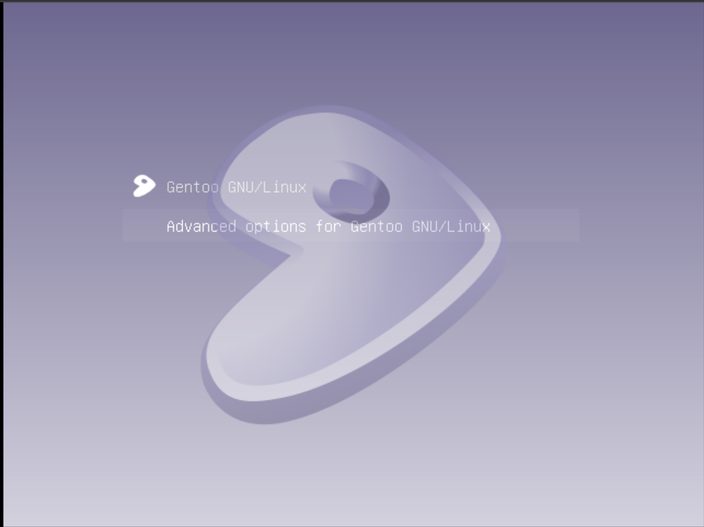
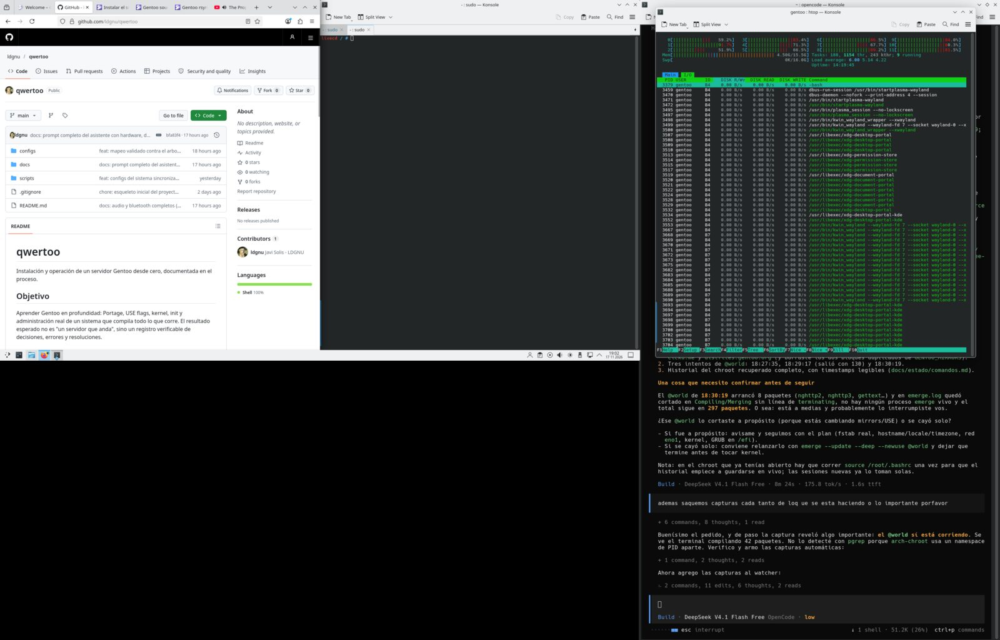
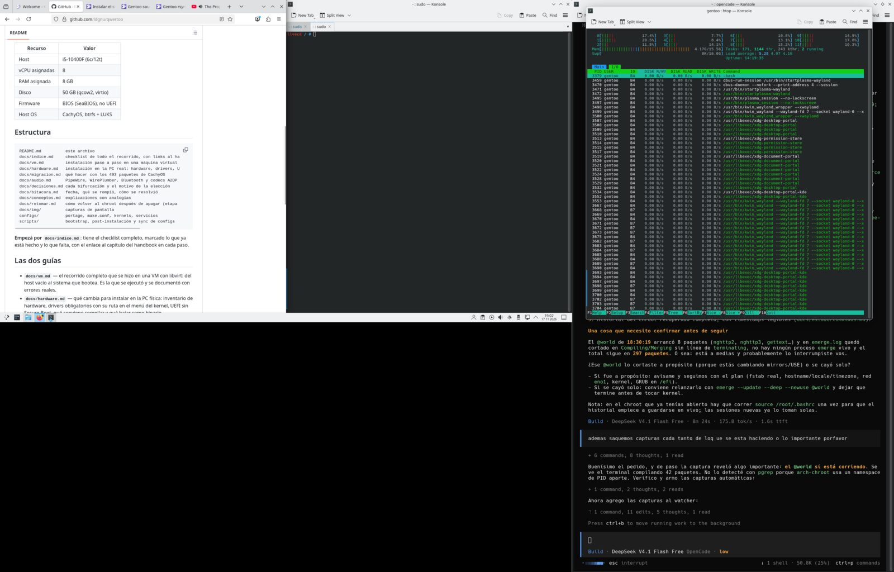
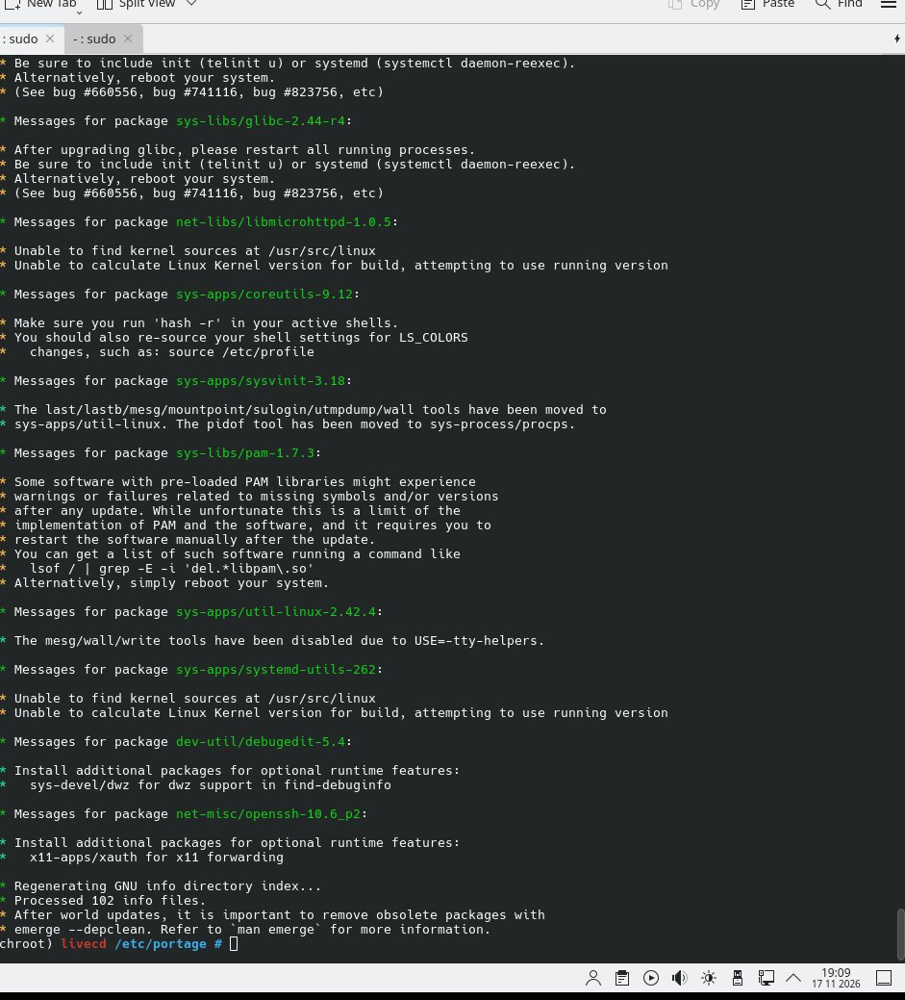
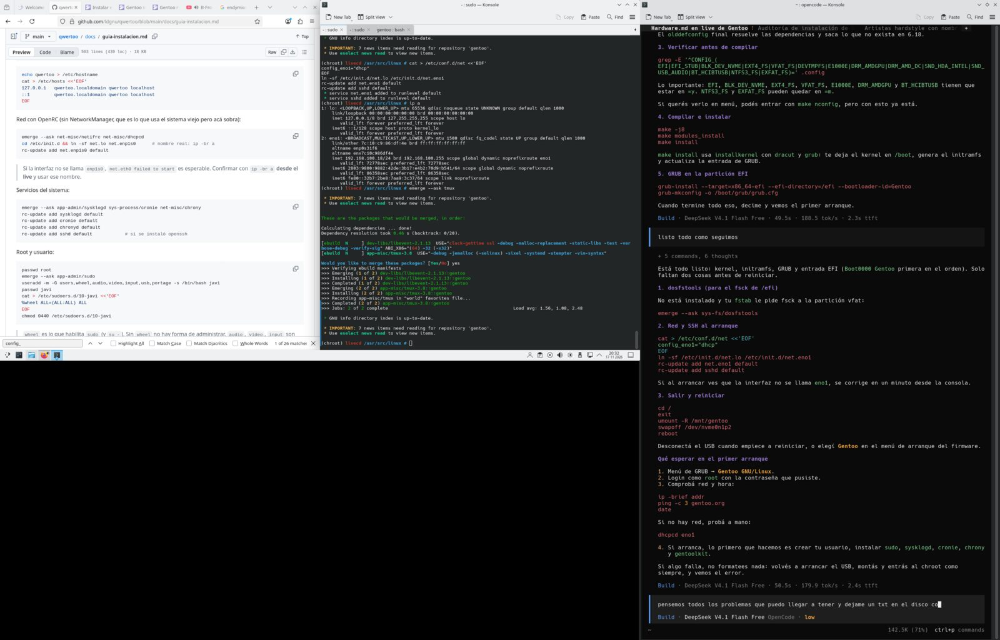
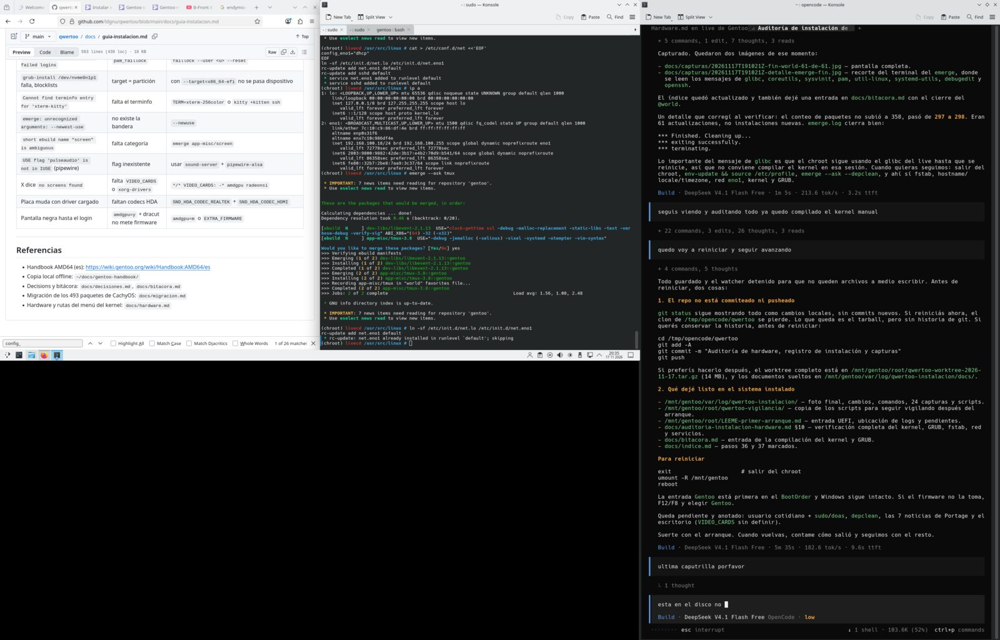

# Gentoo en endymion

*Instalé Gentoo desde cero en mi equipo principal. Esto es el registro: qué hice, qué se
rompió y qué aprendí.*

**endymion** — i5-10400F, 15 GiB, Radeon RX 6600, NVMe de 512 GB.
Gentoo amd64, OpenRC, kernel 7.3.5, Sway sobre Wayland.
Instalación en hardware: **17 de noviembre de 2026**. Última auditoría: **20 de noviembre**.

Durante toda la instalación corrió un watcher que sacaba una captura cada 20 segundos y
guardaba cada cambio del sistema. Las imágenes de abajo son de ahí: no son fotos armadas
después, son el proceso tal como pasó.

*17/11, 19:10. Sesenta y un paquetes compilados. Ahí supe que el sistema iba a arrancar.*

---

## Por qué

Venía de CachyOS: Arch con btrfs, LUKS y systemd. Andaba bien. El problema no era que
fallara, era que no entendía qué hacía cada capa. Gentoo promete lo contrario —que cada
pieza esté ahí porque la pusiste vos— y eso me obligó a bajar hasta el kernel.

Lo ensayé dos días en una máquina virtual antes de tocar el disco. Fue la mejor decisión de
todo el proceso: los errores caros se pagaron en un disco virtual, no en el NVMe.

## Cómo fue

| Fecha | Etapa | Resultado |
|---|---|---|
| 15–16/11 | VM con libvirt, BIOS, 50 GB | Stage3, perfil, primer `@world`, primer kernel |
| 17/11 | Hardware, NVMe reparticionado | 61 paquetes, kernel 6.18.63, GRUB EFI, primer arranque |
| 17–18/11 | Escritorio | Sway, PipeWire, Bluetooth, Zen, Steam, Tailscale |
| 18–19/11 | Kernel 7.3.5 | Upgrade de rama y rebuild para `CONFIG_TUN` |

Cinco días. **697 merges** de Portage en 66 sesiones, **739 paquetes** hoy, **3 kernels**
compilados y **24 capturas** automáticas.

*19:03. Tres ventanas: la guía, el chroot compilando y el asistente anotando lo que pasaba.*

## Qué salió mal

Casi todo lo que salió mal salió mal una sola vez, y quedó anotado con el mensaje literal en
la [bitácora](docs/bitacora.md).

- **El kernel, por opaco, no por difícil.** `localmodconfig` se comió `NTFS3`, `exFAT` y
  Bluetooth porque en el live no estaban cargados. Y cuando Tailscale pidió `/dev/net/tun`,
  el kernel no sabía qué era `CONFIG_TUN`: otro build.
- **Los nombres de red.** `eth0` en la documentación, `enp1s0` en la VM, `eno1` en el hierro.
  Más `dhcpcd` y `netifrc` peleando por la misma interfaz.
- **`pam_faillock`.** Tres intentos fallidos bloquean la cuenta ocho minutos, y el mensaje
  habla de SSH. Busqué en el lugar equivocado.
- **Un mirror muerto.** `gentoo.zero.com.ar` está primero en `GENTOO_MIRRORS` y no resuelve
  por DNS. Cada descarga perdía tiempo ahí.
- **`wofi`.** Nunca arrancó. Terminé poniendo `wmenu`.

*El `nconfig` del 6.18.63. Cada opción es una decisión: qué va adentro, qué va como módulo y
qué no existe.*

## Lo que me gustó

**El kernel, driver por driver.** Es lo mejor de la experiencia. Un kernel no es un programa
que "hace andar Linux", es el traductor entre el hardware y el resto del sistema, y cada
opción de `.config` responde a "¿quién se encarga de esto?". `CONFIG_BLK_DEV_NVME=y` porque
sin eso no hay disco donde montar la raíz; `CONFIG_DRM_AMDGPU=m` porque la placa puede
esperar. Todo tiene un porqué escrito en un archivo que edité yo.

**OpenRC se deja leer.** Son scripts de shell. Cuando algo no arranca, abrís
`/etc/init.d/net.eno1` y entendés por qué. No hay una capa que te esconda el motivo.

**El `@world`.** 61 paquetes la primera vez en hardware, sin una sola dependencia rota.

*El primer arranque. La entrada UEFI quedó primera y Windows siguió intacto en su disco.*

## ¿Es solo un Arch?

No, pero se le parece, y es mi culpa. Usé binarios para lo pesado, puse `~amd64` global, y
apliqué flags propios en dos paquetes. Cuando no cambiás las decisiones de compilación,
Gentoo se siente igual que Arch porque el software es el mismo.

La diferencia real que ya tengo: OpenRC, kernel propio y cadena de herramientas propia. La
que todavía no probé: recortar USE, terminar el ABI de 32 bits, LTO donde importa. Lo
desarrollo en [experiencia](docs/experiencia.md).

## Lo que falta

1. **102 rebuilds pendientes** por `ABI_X86="64 32"`, que se agregó para Steam y nunca se
   completó. `/usr/lib32` está vacío. Es la deuda más grande.
2. **Firewall.** No hay: el kernel no tiene tablas `iptables` ni `nftables`, y `sshd`
   escucha en todas las interfaces.
3. **Dos decisiones sin registrar:** el disco quedó sin cifrado en reposo (el anterior era
   LUKS) y nunca hubo backup del sistema viejo.

El detalle completo, con 19 hallazgos priorizados, está en la
[auditoría del 20/11](docs/auditorias/2026-11-20/README.md).

## La galería

Todas las capturas son del 17/11 y las sacó el watcher. Están las 24 en
[`docs/registro-instalacion/capturas/`](docs/registro-instalacion/capturas/).

*19:03. Arranca el watcher: una foto cada 20 segundos y un diff de cada archivo que cambia.*

*La prueba manual antes de dejarlo solo. El repo abierto en el navegador y el chroot al lado.*

*19:10. Los últimos mensajes del `@world`: glibc pidiendo reiniciar procesos, el aviso de
`hash -r` y el de `--depclean`.*

*20:33. Kernel, initramfs, GRUB y la entrada UEFI. Ya solo faltaba reiniciar.*

*20:36. La última: todo guardado, el repo en un tarball y el dedo en `reboot`.*

## El repositorio

| Dónde | Qué |
|---|---|
| [`docs/guia-instalacion.md`](docs/guia-instalacion.md) | La guía ejecutable, de arriba abajo, sin handbook |
| [`docs/indice.md`](docs/indice.md) | Checklist del recorrido |
| [`docs/bitacora.md`](docs/bitacora.md) | Fecha, qué se rompió, cómo se resolvió |
| [`docs/cronologia.md`](docs/cronologia.md) | El recorrido consolidado, de la VM al kernel 7.3.5 |
| [`docs/experiencia.md`](docs/experiencia.md) | La vivencia y la comparación con Arch, sin filtro |
| [`docs/auditorias/`](docs/auditorias/) | Auditorías fechadas del sistema en funcionamiento |
| [`docs/registro-instalacion/`](docs/registro-instalacion/) | El watcher: comandos, cambios y las 24 capturas |
| [`docs/historial-paquetes.md`](docs/historial-paquetes.md) | Cada sesión de `emerge` con fecha y paquetes |
| [`docs/hardware.md`](docs/hardware.md) | Qué driver necesita cada componente y dónde está en el menú del kernel |
| [`docs/audio.md`](docs/audio.md) | PipeWire, WirePlumber, Bluetooth y codecs A2DP |
| [`docs/vm.md`](docs/vm.md) | La instalación de práctica, como laboratorio |
| [`docs/decisiones.md`](docs/decisiones.md) | Cada bifurcación y el motivo |
| [`configs/`](configs/) | Portage, kernel, servicios y configuración de Sway |
| [`scripts/`](scripts/) | Bootstrap, post-instalación y sync de configs |

Si querés instalar: `docs/guia-instalacion.md`. Si querés saber qué pasó acá:
`docs/cronologia.md`. Si querés la opinión: `docs/experiencia.md`.

## Reglas del repositorio

Solo texto y configuración. Las capturas van como evidencia en `docs/img/` y
`docs/registro-instalacion/capturas/`. Nunca claves, tokens, contraseñas ni direcciones
internas: todo lo que entre al historial sigue ahí.
