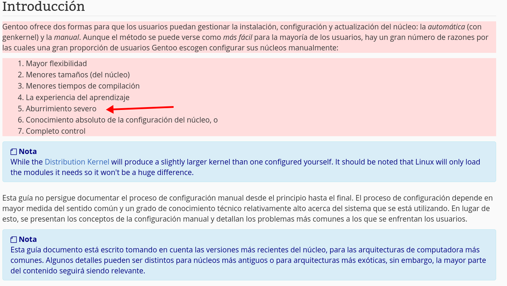
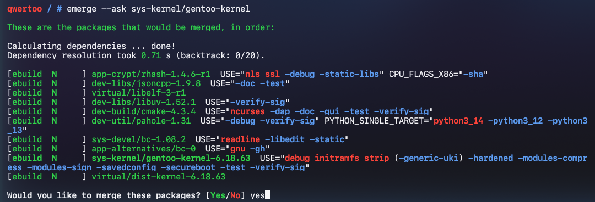
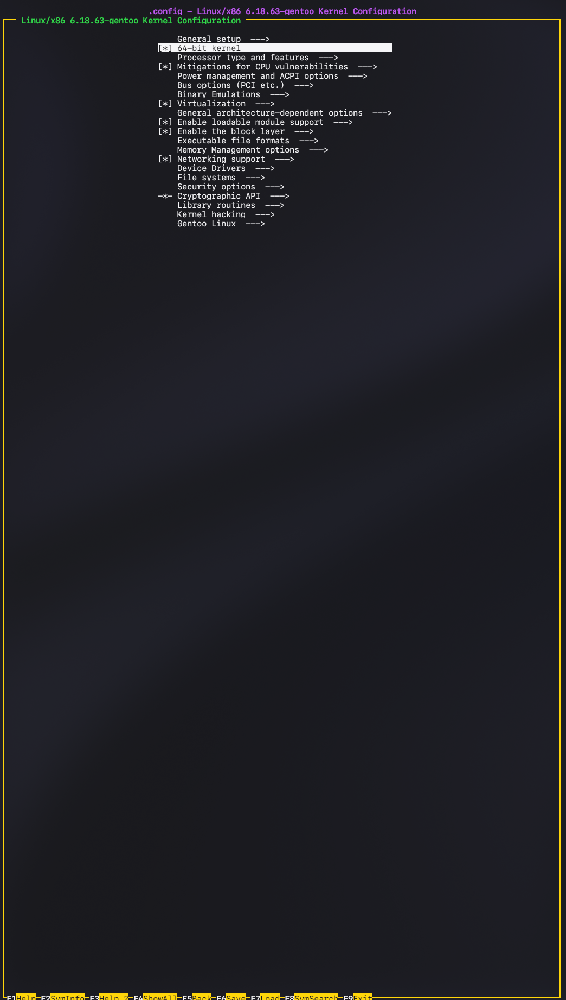

# Guía: servidor Gentoo en una VM

Recorrido real de la instalación, en orden, con los comandos que se usaron, lo que
apareció en pantalla y los errores que hubo que resolver. No es una copia del handbook:
es lo que pasó en esta máquina.

Entorno: CachyOS como host, VM KVM con libvirt, disco virtio de 50 GB, firmware BIOS.

El handbook lista siete razones para configurar el kernel a mano. La quinta es
"aburrimiento severo", y es la que aplica acá:




---

## 1. Preparar el host

Antes de crear la VM hacen falta cuatro cosas en el host: el emulador, el demonio de
libvirt, el almacenamiento y la red.

Lo que suele faltar es QEMU: `libvirt` y `virt-manager` no lo traen como dependencia.

```
sudo pacman -S qemu-desktop
```

Y los daemons de almacenamiento, que en libvirt 12 son un servicio aparte:

```
sudo systemctl enable --now virtstoraged.socket
```

**Error típico:** virt-manager dice `No existe el fichero o el directorio` sobre
`/var/run/libvirt/virtstoraged-sock`. No es la VM: es el daemon apagado.

**Error típico:** `network 'default' is not active` aunque la red figure activa. Suele ser
`virsh` hablando con `qemu:///session` en vez de `qemu:///system`. Siempre:

```
virsh -c qemu:///system net-list --all
```

---

## 2. Verificar la ISO

```
curl -O https://distfiles.gentoo.org/releases/amd64/autobuilds/<fecha>/install-amd64-minimal-<fecha>.iso.asc
curl -sSL https://qa-reports.gentoo.org/output/service-keys.gpg | gpg --import
gpg --verify install-amd64-minimal-<fecha>.iso.asc install-amd64-minimal-<fecha>.iso
```

Resultado esperado:

```
gpg: Firma correcta de "Gentoo Linux Release Engineering (Automated Weekly Release Key)"
      13EBBDBEDE7A12775DFDB1BABB572E0E2D182910
```


**Error típico:** pedir `...tar.asc` en vez de `...tar.xz.asc`, o verificar el archivo
directamente con gpg (`invalid packet`). El `.asc` tiene que corresponder al nombre exacto.

---

## 3. Crear la VM

En virt-manager, sobre la conexión `QEMU/KVM` (system), no `User session`.
Los valores usados: 8 vCPU, 8 GB de RAM, disco virtio de 50 GB, red virtio en la red
`default`, ISO como CD.

---

## 4. Levantar la red del live

```
passwd root
/etc/init.d/sshd start
ip -br addr
```

Con la IP, desde el host:

```
ssh root@192.168.122.x
```

**Atajo útil:** la IP se descubre sin mirar la pantalla.

```
virsh -c qemu:///system net-dhcp-leases default
```

**Error típico:** `Cannot find terminfo entry for 'xterm-kitty'`. Se resuelve con
`kitty +kitten ssh root@...` o con `TERM=xterm-256color ssh ...`.

---

## 5. Particionado

Disco `vda` de 50 GB, tabla GPT, firmware BIOS. En BIOS con GPT hace falta una partición
`BIOS boot` de 1 MiB, o `grub-install` falla después.

| Partición | Tamaño | Tipo | Uso |
|---|---|---|---|
| vda1 | 1 MiB | BIOS boot | GRUB |
| vda2 | 1 GiB | ext4 | /boot |
| vda3 | 4 GiB | swap | swap |
| vda4 | ~45 GiB | ext4 | / |

```
cfdisk /dev/vda
```

Los tipos se confirman con `sfdisk -d`, porque `lsblk -f` no muestra el GUID:

```
/dev/vda1 : type=21686148-6449-6E6F-744E-656564454649   (BIOS boot)
/dev/vda3 : type=0657FD6D-A4AB-43C4-84E5-0933C84B4F4F   (Linux swap)
```


**Error típico:** escribir el tipo equivocado en `vda1`. Se cambia con `Type` en cfdisk
antes de escribir la tabla.

---

## 6. Formatear y montar

```
mkfs.ext4 -L boot /dev/vda2
mkswap -L swap /dev/vda3
mkfs.ext4 -L root /dev/vda4
```

El orden de montaje importa:

```
mount /dev/vda4 /mnt/gentoo
mkdir -p /mnt/gentoo/boot
mount /dev/vda2 /mnt/gentoo/boot
swapon /dev/vda3
```

**Error típico:** crear `/mnt/gentoo/boot` antes de montar la raíz. Al montar `vda4` encima,
ese directorio queda tapado y el siguiente `mount` dice `mount point does not exist`.

---

## 7. Stage3

```
cd /mnt/gentoo
wget https://distfiles.gentoo.org/releases/amd64/autobuilds/<fecha>/stage3-amd64-openrc-<fecha>.tar.xz
gpg --verify stage3-amd64-openrc-<fecha>.tar.xz.asc
tar xpvf stage3-amd64-openrc-<fecha>.tar.xz \
    --xattrs-include='*.*' --numeric-owner -C /mnt/gentoo
```

`-C` fija el destino: el live corre en RAM, y extraer 1.5 GB en tmpfs puede matar la sesión.


---

## 8. make.conf

```
COMMON_FLAGS="-march=skylake -O2 -pipe"
CFLAGS="${COMMON_FLAGS}"
CXXFLAGS="${COMMON_FLAGS}"
FCFLAGS="${COMMON_FLAGS}"
FFLAGS="${COMMON_FLAGS}"
MAKEOPTS="-j6 -l6"
ACCEPT_LICENSE="-* @FREE @BINARY-REDISTRIBUTABLE"
```

`-march=native` también sirve con la CPU en `host-passthrough`, pero ata los binarios a
esa CPU. `skylake` es portable.

`MAKEOPTS="-j6"` y no `-j8` porque el limitante es la RAM: ocho compiladores en 8 GB
terminan en OOM en paquetes como llvm.

---

## 9. Chroot

```
cp --dereference /etc/resolv.conf /mnt/gentoo/etc/
arch-chroot /mnt/gentoo
```

`arch-chroot` monta `/proc`, `/sys`, `/dev`, `/run` y copia `resolv.conf`. Es del mundo
Arch, pero el live de Gentoo lo trae y hace exactamente lo que el handbook pide a mano.

---

## 10. Repositorio, sync y perfil

```
mkdir --parents /etc/portage/repos.conf
cp /usr/share/portage/config/repos.conf /etc/portage/repos.conf/gentoo.conf
emerge --sync
eselect profile list
```

Perfil elegido: `default/linux/amd64/23.0/no-multilib`. Sin perfil de escritorio: es un
servidor.


---

## 11. Locale, fstab, hostname, password

```
nano /etc/locale.gen      # en_US.UTF-8 UTF-8 / es_AR.UTF-8 UTF-8
locale-gen
eselect locale set 5
env-update && source /etc/profile
```

`/etc/fstab`:

```
LABEL=root   /       ext4   defaults,noatime   0 1
LABEL=boot   /boot   ext4   defaults,noatime   0 2
LABEL=swap   none    swap   sw                 0 0
```

`/boot` **sin** `noauto`, o GRUB lee un directorio vacío.

```
echo qwertoo > /etc/hostname
passwd
```

---

## 12. Kernel

Antes de compilar: `gentoo-kernel` (distribution kernel) resuelve todo solo, compilando con
la configuración de Gentoo. Se descartó a propósito para hacer la configuración a mano.



```
emerge --ask sys-kernel/gentoo-sources
eselect kernel set 1
cd /usr/src/linux
make localmodconfig
make nconfig
```

Lo que no puede faltar como `=y`:

```
CONFIG_VIRTIO_PCI
CONFIG_VIRTIO_BLK
CONFIG_VIRTIO_NET
CONFIG_EXT4_FS
CONFIG_DEVTMPFS
CONFIG_DEVTMPFS_MOUNT
```



Compilar e instalar:

```
make -j6
make modules_install
make install
```


Con `installkernel` en `USE="dracut grub"`, ese último paso genera el initramfs y actualiza
`grub.cfg` solo.

---

## 13. Bootloader

```
grub-install /dev/vda
```

El target es el **disco**, no una partición. Con `/dev/vda2` falla con
`will not proceed with blocklists`.

---

## 14. Primer arranque

Apagar la VM, sacar el CD y arrancar del disco.


---

Nota sobre las capturas: se agregan cuando existen. Las que faltan se toman en el momento
en que ocurre cada etapa; no se reconstruyen después.
